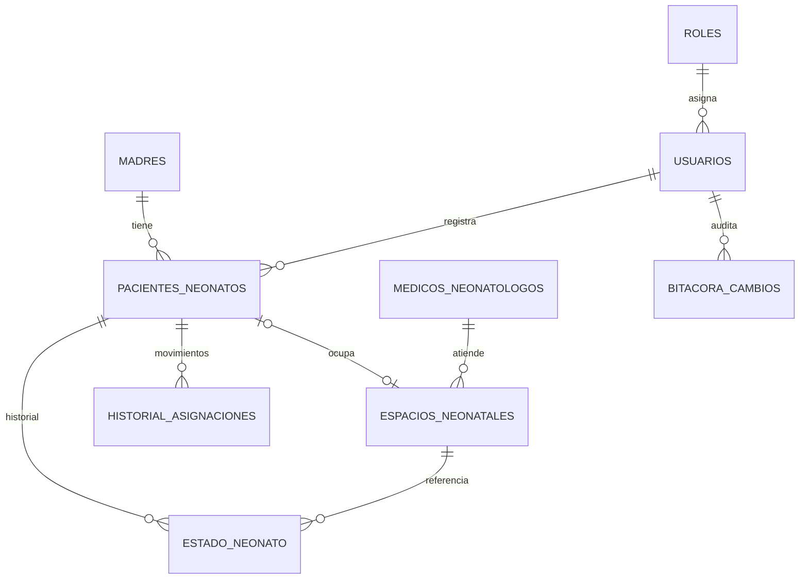

# Diagrama ER textual SCUCIN

- `roles` 1:N `usuarios`.
- `madres` 1:N `pacientes_neonatos` (cada neonato se vincula obligatoriamente a una madre).
- `usuarios` 1:N `pacientes_neonatos` (registrado_por).
- `pacientes_neonatos` 0:1 `espacios_neonatales` en la asignación activa; `UNIQUE(id_neonato)` evita dos espacios simultáneos.
- `medicos_neonatologos` 1:N `espacios_neonatales` (médico tratante actual).
- `pacientes_neonatos` 1:N `estado_neonato` (historial clínico, no se sobrescribe).
- `espacios_neonatales` 1:N `estado_neonato` (referencia histórica al espacio).
- `pacientes_neonatos` 1:N `historial_asignaciones`; cada evento registra espacio anterior/nuevo y usuario.
- `usuarios` 1:N `bitacora_cambios` (auditoría).

